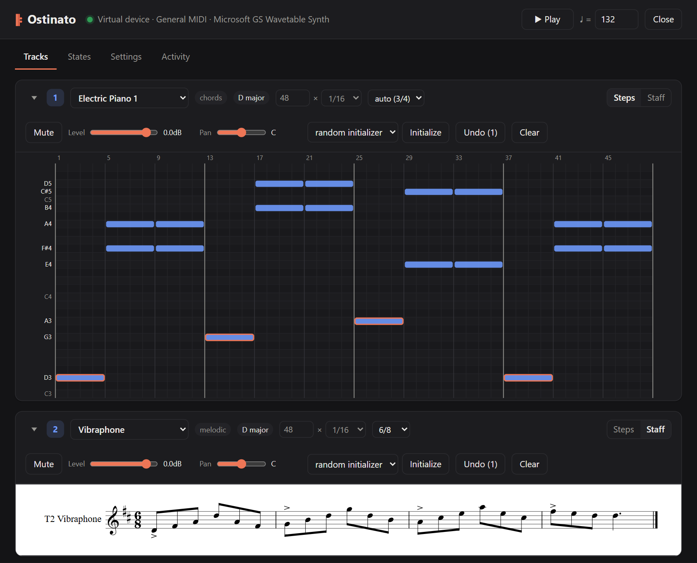
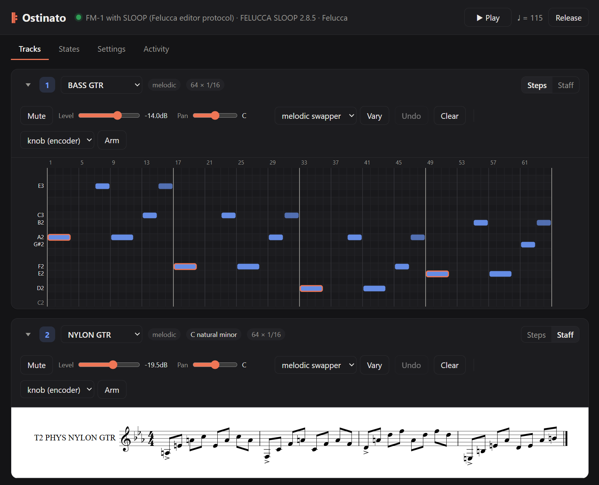
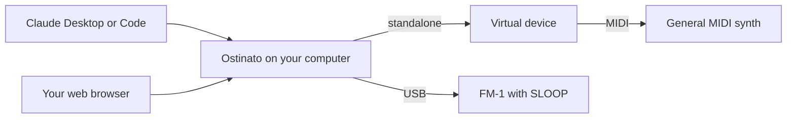

# 𝄆 Ostinato

**A sequencer you can talk to, with or without hardware.** Ostinato gives you four tracks of step patterns that you see
as notes in your browser and shape by talking to Claude: write melodies by describing them, grow variations, choose
sounds, mix, and keep every version on your computer.



**Use it on its own.** The built-in **virtual device** plays your patterns through your computer with General MIDI
sounds. You need no hardware.

**Or use it with a groovebox.** Today that is the **M-VAVE FM-1 running the
[SLOOP firmware](https://github.com/isod89/sloop-fm1)**, over USB. Everything musical in Ostinato is built for any
device, so more can follow. Sketches move between the two.

> *"Write a waltz in D major on track 1."*  ·  *"Show me track 2 as sheet music."*  ·
> *"Make track 2 a 6/8 vibraphone melody."*  ·  *"Take the hi-hats out of the drums."*  ·
> *"Save this as 'before the gig'."*

---

## Standalone, or with an FM-1

| | Standalone (virtual device) | FM-1 with SLOOP |
| --- | --- | --- |
| **You need** | a computer; for sound, a General MIDI synth (Windows has one) | the FM-1, connected by USB |
| **Tracks** | 3 melodic + drums, up to 64 steps each | 3 synth + drums, up to 64 steps each |
| **Sounds** | 128 General MIDI sounds, 8 drum kits | the FM-1's own presets and kits |
| **Key and scale** | one for all melodic tracks, set in Ostinato | each track's, as set on the FM-1 |
| **Time signatures** | per track | per track |
| **Staffs, writing, algorithms, undo, mix, tempo** | yes | yes |
| **Generative mode** (a knob drives an algorithm) | no: press **Vary** or **Initialize** | yes |
| **Your patterns are kept** | on your computer, by themselves | on the FM-1 when you save the project there |
| **Saved states** | yes | yes, also as an exact copy |

Start standalone with **Use the virtual device** on the page, in the tray menu, or by asking Claude. Ostinato never
switches to it, or away from it, by itself:

- **Close** leaves the virtual device; your patterns are there the next time.
- Plug in an FM-1, and the page offers to **switch** to it.
- **Take a sketch with you**: save a state on one, apply it on the other. The notes, time signatures, levels, pan and
  tempo go along; sounds only where both have one of that name, and the drum level not onto the FM-1.

---

## What you can do

### 🎼 See your music
- Every track as a step grid, a piano roll, a detailed note list or **real notation on a staff**, updated live.
- Export a track or the whole song as **MusicXML** for MuseScore, Sibelius or Dorico.
- Ask about keys and scales: which key a track is in, which notes fit, which ones step outside.

### 🎵 Any key, any time signature
- **Key signatures**: staffs show the track's key and spell its notes accordingly (Db, not C#, where the key says so), and
  the algorithms stay in the scale. Standalone you choose among 12 roots and 15 scales, from major and the modes to
  blues and diminished; it starts in C major. On the FM-1 the key is the one you set on the device.
- **Time signatures**: each track has its own: 2/4 to 7/4, 3/8, 6/8, 7/8, 9/8 or 12/8. *auto* goes by the pattern's length
  (12 steps of 1/16 are 3/4, 16 are 4/4); 6/8 you choose, as it is as long as 3/4. Bars, beams, rests and the roll's bar
  lines follow it.
- **Pattern length**: from 1 to 64 steps, of any step length from 2 bars down to 1/32, triplets included. Tracks of
  different lengths drift against each other as they loop.

### ✍️ Write and edit
- **Write notes** by describing them to Claude, or have it load a **MIDI file** onto a track, with its time signature.
  Ostinato fits them to what the device can play and tells you if anything had to change.
- **Clear** a whole track, every A3, or just one drum lane such as the hi-hats.
- **Undo** any of this, step by step (up to 30 steps per track).

### 🎲 Generate
- **Start** from a random pattern in the track's key, or a four on the floor on the drums.
- **Vary** what is there: swap notes within the scale, mutate a phrase, add spice (gate lengths, ratchets, rests).
- **Generative mode** (FM-1) puts it on the device: turn a knob and the pattern evolves as it plays, turn it back to undo.

All six algorithms and their settings are in [ALGORITHMS.md](ALGORITHMS.md).

### 🎛️ Sound and mix
- **Choose a sound** for each track: General MIDI standalone, every factory preset on the FM-1 (153 on SLOOP 2.8, across
  12 synth engines), or a drum kit.
- Set **level** and **pan**, **mute** tracks, set the **tempo**, and **start / stop** playback. You hear changes as it plays.

### 💾 Keep your work
Ostinato saves the **whole state** (every note, sound, mix and setting) to a file on your computer, as often as you like.
- **Load** a saved state to look at it and compare it with the device before anything changes.
- **Apply** all of it, or only part: one track, or only its notes, its sound or its mix, also while the song plays.
- On the FM-1, which has room for very few songs, you can also put back an **exact copy** of its project, byte for byte
  (with the song stopped).
- Before every apply, the device as it was is saved as *"before apply"*, so nothing is ever lost.

### 🖥️ A page in your browser
Tracks with live step rolls and staffs; menus for sound, pattern length and time signature; level and pan; Initialize / Vary /
Undo / Clear; play and tempo; saved states; settings for every algorithm, the key and the sound output; and a log of everything
that happened. You can use the page without Claude. Writing particular notes is Claude's part.



---

## How it works



Ostinato is a small program you leave running on your computer while you make music. Claude and the browser page both talk
to it, and it works on one device at a time: the virtual one, or the FM-1, where it also notices what you change on the device
itself. Ostinato itself sends nothing anywhere else; Claude sees what its tools answer.

Standalone, every change is kept by itself. On the FM-1, changes go to its memory, as edits on the device do: to keep them, save
the project on the FM-1, or save a state in Ostinato.

---

## Install on Windows (no Python needed)

1. Download **`Ostinato-Setup-<version>.exe`** from the
   [Releases page](https://github.com/androbi-com/ostinato/releases) and run it.
2. Leave **"Connect Ostinato to Claude Desktop"** ticked if you use Claude Desktop, and choose whether Ostinato
   should start when you sign in to Windows.
3. Start **Ostinato** from the Start menu. It waits in the **tray, next to the clock**, and opens its page in your browser.
   - **Standalone**: press **Use the virtual device**, then **Initialize** on a track and **Play**.
   - **With an FM-1**: plug it in. The tray icon has a green dot when it is connected.
4. If you connected Claude Desktop, restart it once.

Windows may say *"Windows protected your PC"* the first time, because the installer is not signed: click
**More info**, then **Run anyway**. Uninstall from Windows' *Installed apps*: your saved states are kept unless you
choose otherwise.

---

## Quick start (from source, any system)

You need [uv](https://docs.astral.sh/uv/). An FM-1 is optional.

**1. Install**

```bash
git clone https://github.com/androbi-com/ostinato.git
cd ostinato
uv sync
```

**2. Start the device server** and leave it running (Ctrl+C stops it). Standalone:

```bash
uv run ostinato-device --virtual
```

With an FM-1 (it finds it by itself, and keeps looking every few seconds if it is not plugged in yet):

```bash
uv run ostinato-device
```

**3. Open the browser page**, from a second terminal in the same folder:

```bash
uv run ostinato-device ui
```

**4. Connect Claude Desktop** (optional). Add this to `claude_desktop_config.json` (on Windows in
`%APPDATA%\Claude\`, on macOS in `~/Library/Application Support/Claude/`), with your own paths:

```json
"mcpServers": {
  "ostinato": {
    "command": "C:\\Users\\<you>\\.local\\bin\\uv.exe",
    "args": ["--directory", "C:\\path\\to\\ostinato", "run", "ostinato-mcp"]
  }
}
```

Restart Claude Desktop, and Ostinato's tools are there. Claude Code works the same way (`claude mcp add`).

### Sound, standalone
- **Windows**: the built-in *Microsoft GS Wavetable Synth*, found by itself.
- **macOS, Linux**: start a General MIDI synth with a MIDI port, such as FluidSynth or TiMidity.
- **Any other MIDI output**, such as a synth, a DAW or a loopback port: choose it under **Settings → Virtual device** (there while it is in use). Tracks
  1-3 play on MIDI channels 1-3, the drums on channel 10.
- Without a synth, everything works silently.

---

## Things to ask Claude

| | |
| --- | --- |
| **Standalone** | *"Use the virtual device."* · *"Set the key to A minor."* · *"Switch to the FM-1."* |
| **Look** | *"What's on the device right now?"* · *"Show track 1 as a staff."* · *"Which scale is track 2 in, and which notes fit?"* |
| **Write** | *"Write C4 E4 G4 C5 as quarter notes on track 1."* · *"Put this MIDI file on track 3."* · *"Write a four-on-the-floor beat with offbeat hats on track 4."* |
| **Meter** | *"Write a waltz on track 1."* · *"Track 2 is in 6/8."* · *"Make track 3 a 7/8 loop of 14 steps."* |
| **Edit** | *"Clear track 2."* · *"Remove every A3 from track 1."* · *"Undo that."* |
| **Vary** | *"Make a variation of track 1 with melodic_swapper."* · *"Spice up the drums a little."* · FM-1: *"Arm generative mode on track 2 with the knob."* |
| **Sound** | *"Which sounds can track 3 have?"* · standalone: *"Give track 3 the marimba."* · FM-1: *"Give track 3 the Rhodes."* |
| **Mix** | *"Turn track 2 down 3 dB and pan it 30% left."* · *"Mute track 4."* · *"Start playing."* / *"Stop."* · *"Set the tempo to 124."* |
| **Keep** | *"Save this as 'verse idea'."* · *"Which states have I saved?"* · *"Load 'verse idea' and tell me what's different."* · *"Put back only the drums from it."* |

---

## Troubleshooting

**The virtual device is silent.** The page's header says which MIDI output it plays on; *no sound output* means no synth
was found (see [Sound, standalone](#sound-standalone)). *"Another program may be using it"*: the Microsoft synth takes one
program at a time; close the other one, or choose another output in the settings.

**The FM-1 is not found.** Check the USB cable and that SLOOP is running. To pick the port by name:
`uv run ostinato-device --midi-port Felucca` (any part of the port's name).

**The FM-1 is plugged in, but Ostinato stays on the virtual device.** It does not switch by itself: press **Switch to ...** in
the header, or ask Claude.

**You want to use the SLOOP web editor.** Only one program can talk to the FM-1 at a time. Press **Release** in the
page (or ask Claude to disconnect), use the editor, then **Reconnect**. Meanwhile you can use the virtual device.

**The staff has the wrong bars.** Choose the track's time signature: *auto* only knows the pattern's length.

**Claude doesn't show the newest tools.** Restart Claude once after the device server first starts, or after an
update.

**"Failed to canonicalize script path"** after moving or renaming the folder: run `uv sync --reinstall` once.

---

## More

- [README_TECHNICAL.md](README_TECHNICAL.md): how it is built, every tool, the file formats, the virtual device, the
  SLOOP protocol details, and how to add a device.
- [ALGORITHMS.md](ALGORITHMS.md): the generative algorithms and all their settings.

---

## License

Ostinato is free software under the [GNU General Public License v3.0](LICENSE) (GPL-3.0-only): you may use, share
and change it, and versions you pass on stay under the same license.

It talks to the FM-1 through the editor protocol of [SLOOP](https://github.com/isod89/sloop-fm1) by Leo Kuroshita
(Hügelton Instruments), also GPL-3.0-only, and parts of Ostinato are based on SLOOP's web editor. Thank you!

Ostinato is an independent project. M-VAVE and FM-1 are trademarks of their respective owners, who do not endorse or
support it.
