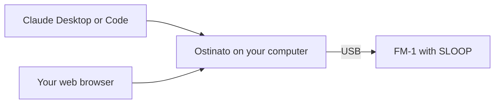

# 𝄆 Ostinato

**Talk to your groovebox.** Ostinato connects a hardware sequencer to Claude and to a page in your browser, so you can see your patterns as notes, write melodies by describing them, grow variations, shape the
mix and keep every version of your song on your computer.


Today it works with the **M-VAVE FM-1 running the [SLOOP firmware](https://github.com/isod89/sloop-fm1)**. Everything
musical in Ostinato is built for any device, so more can follow.

> *"Show me track 2 as sheet music."*  ·  *"Write a walking bass in A minor on track 1."*  ·
> *"Take the hi-hats out of the drums."*  ·  *"Give track 3 a marimba and pan it a little left."*  ·
> *"Save this as 'before the gig'."*

---

## What you can do

### 🎼 See your music
- Every track as a step grid, a piano roll, a detailed note list or **real notation on a staff**, updated live as you
  edit on the device.
- Export a track or the whole song as **MusicXML** for MuseScore, Sibelius or Dorico.
- Ask about keys and scales: which key a track is in, which notes fit, which ones step outside.

### ✍️ Write and edit
- **Write notes** by describing them, or load a **MIDI file** onto a track. Ostinato fits them to what the device can
  play and tells you if anything had to change.
- **Clear** a whole track, every A3, or just one drum lane such as the hi-hats.
- **Undo** any of this, step by step (up to 30 steps per track).

### 🎲 Generate
- **Vary** a track with one of five algorithms: swap notes within the scale, mutate a phrase, add spice (gate
  lengths, ratchets, rests), or start from a fresh random pattern in the track's key.
- **Generative mode** puts it on the device: turn a knob on the FM-1 and the pattern evolves as it plays, turn it back
  to undo. See [ALGORITHMS.md](ALGORITHMS.md).

### 🎛️ Sound and mix
- **Choose a sound** for each track from every preset on the device (153 on SLOOP 2.8, across 12 synth engines), or a
  drum kit.
- Set **level** and **pan**, **mute** tracks, set the **tempo**, and **start / stop** playback.

### 💾 Keep your work
The FM-1 has room for very few songs. Ostinato saves the device's **whole state** (every note, sound, mix and
setting) to a file on your computer, as often as you like.
- **Load** a saved state to look at it and compare it with the device before anything changes.
- **Apply** all of it, or only part: one track, or only its notes, its sound or its mix. This works while the song
  plays.
- Or put back an **exact copy** of the device's project, byte for byte (with the song stopped).
- Before every apply, the device as it was is saved as *"before apply"*, so nothing is ever lost.

### 🖥️ A page in your browser
Tracks with live step rolls and staffs, a sound menu, level and pan sliders, Mute / Vary / Undo / Clear,
generative mode, a play button, a tempo field, saved states, settings for every algorithm, and a log of everything that happened.

---

## How it works



Ostinato is a small program you leave running on your computer while you make music (`uv run ostinato-device`).
Claude and the browser page both talk to it, and it is the only one that talks to the FM-1. It also notices what
you change on the device itself. Nothing leaves your computer.

Changes go to the FM-1's memory, as edits on the device do: to keep them, save the project on the FM-1, or save a
state in Ostinato.

---

## Install on Windows (no Python needed)

1. Download **`Ostinato-Setup-<version>.exe`** from the
   [Releases page](https://github.com/androbi-com/ostinato/releases) and run it.
2. Leave **"Connect Ostinato to Claude Desktop"** ticked if you use Claude Desktop, and choose whether Ostinato
   should start when you sign in to Windows.
3. Plug in your FM-1 and start **Ostinato** from the Start menu. It waits in the **tray, next to the clock**: its
   icon has a green dot when the FM-1 is connected. Click it for the page in your browser, to release the FM-1 for
   the SLOOP editor, or to quit.
4. If you connected Claude Desktop, restart it once.

Windows may say *"Windows protected your PC"* the first time, because the installer is not signed: click
**More info**, then **Run anyway**. Uninstall from Windows' *Installed apps*: your saved states are kept unless you
choose otherwise.

---

## Quick start (from source, any system)

You need [uv](https://docs.astral.sh/uv/) and an FM-1 with SLOOP connected by USB.

**1. Install**

```bash
git clone https://github.com/androbi-com/ostinato.git
cd ostinato
uv sync
```

**2. Start the device server** and leave it running (Ctrl+C stops it):

```bash
uv run ostinato-device
```

It finds the FM-1 by itself (and keeps looking every few seconds if it is not plugged in yet). No FM-1 at hand?
`uv run ostinato-device --simulate` runs a simulated one.

**3. Open the browser page**, from a second terminal in the same folder:

```bash
uv run ostinato-device ui
```

**4. Connect Claude Desktop** (optional). Add this to `claude_desktop_config.json` (on Windows in
`%APPDATA%\Claude\`, on macOS in `~/Library/Application Support/Claude/`), with your own paths:

```json
"mcpServers": {
  "ostinato": {
    "command": "C:\\Users\\<you>\\.local\\bin\\uv.exe",
    "args": ["--directory", "C:\\path\\to\\ostinato", "run", "ostinato-mcp"]
  }
}
```

Restart Claude Desktop, and Ostinato's tools are there. Claude Code works the same way (`claude mcp add`).

---

## Things to ask Claude

| | |
| --- | --- |
| **Look** | *"What's on the FM-1 right now?"* · *"Show track 1 as a staff."* · *"Which scale is track 2 in, and which notes fit?"* |
| **Write** | *"Write C4 E4 G4 C5 as quarter notes on track 1."* · *"Put this MIDI file on track 3."* · *"Write a four-on-the-floor beat with offbeat hats on track 4."* |
| **Edit** | *"Clear track 2."* · *"Remove every A3 from track 1."* · *"Undo that."* |
| **Vary** | *"Make a variation of track 1 with melodic_swapper."* · *"Spice up the drums a little."* · *"Arm generative mode on track 2 with the knob."* |
| **Sound** | *"Which sounds can track 3 have?"* · *"Give track 3 the Rhodes."* · *"Switch the drums to the 909 kit."* |
| **Mix** | *"Turn track 2 down 3 dB and pan it 30% left."* · *"Mute track 4."* · *"Start playing."* / *"Stop."* · *"Set the tempo to 124."* |
| **Keep** | *"Save this as 'verse idea'."* · *"Which states have I saved?"* · *"Load 'verse idea' and tell me what's different."* · *"Put back only the drums from it."* |

---

## Troubleshooting

**The FM-1 is not found.** Check the USB cable and that SLOOP is running. To pick the port by name:
`uv run ostinato-device --midi-port Felucca` (any part of the port's name).

**You want to use the SLOOP web editor.** Only one program can talk to the FM-1 at a time. Press **Release** in the
page (or ask Claude to disconnect), use the editor, then **Reconnect**.

**Claude doesn't show the newest tools.** Restart Claude once after the device server first starts, or after an
update.

**"Failed to canonicalize script path"** after moving or renaming the folder: run `uv sync --reinstall` once.

---

## More

- [README_TECHNICAL.md](README_TECHNICAL.md): how it is built, every tool, the file formats, the SLOOP protocol
  details, and how to add a device.
- [ALGORITHMS.md](ALGORITHMS.md): the generative algorithms and all their settings.

---

## License

Ostinato is free software under the [GNU General Public License v3.0](LICENSE) (GPL-3.0-only): you may use, share
and change it, and versions you pass on stay under the same license.

It talks to the FM-1 through the editor protocol of [SLOOP](https://github.com/isod89/sloop-fm1) by Leo Kuroshita
(Hügelton Instruments), also GPL-3.0-only, and parts of Ostinato are based on SLOOP's web editor. Thank you!

Ostinato is an independent project. M-VAVE and FM-1 are trademarks of their respective owners, who do not endorse or
support it.
